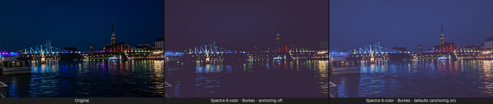
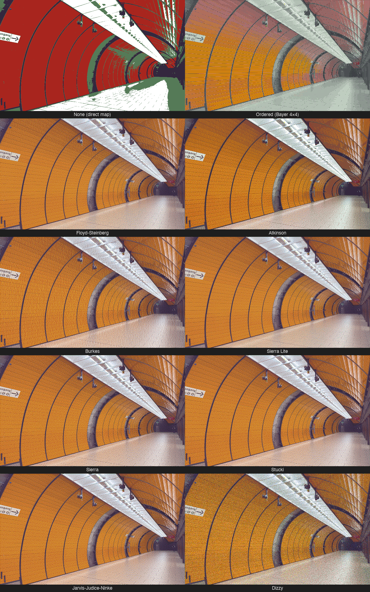
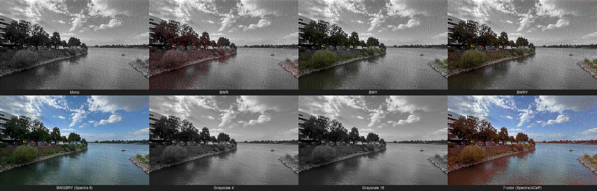
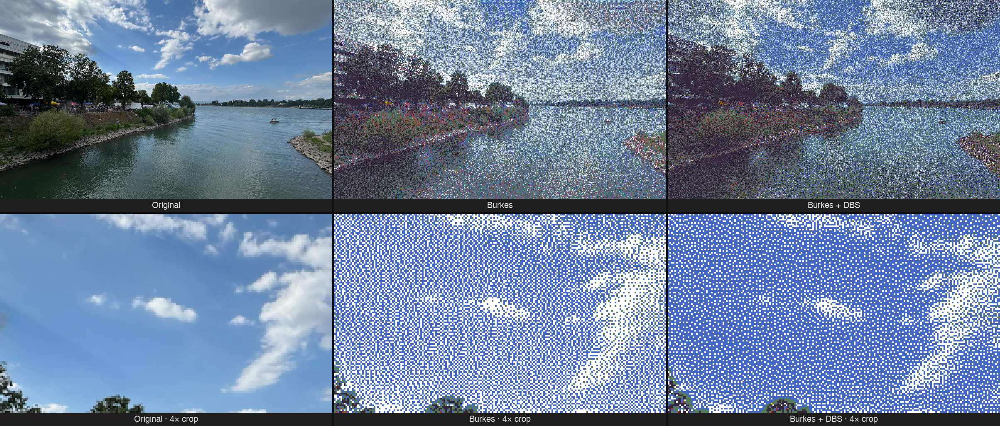

# epaper-dithering

[](https://pypi.org/project/epaper-dithering/)
[](https://www.npmjs.com/package/@opendisplay/epaper-dithering)
[](https://github.com/OpenDisplay-org/epaper-dithering/actions/workflows/python-test.yml)
[](https://github.com/OpenDisplay-org/epaper-dithering/actions/workflows/javascript-test.yml)
[](https://github.com/astral-sh/ruff)

Dithering for e-paper/e-ink displays: an image and your panel's palette in, palette indices out. Rust core with Python, JavaScript/TypeScript and iOS (C ABI) bindings.

The library knows nothing about any particular display or firmware. You describe your panel in a small palette file (measured colours, plus which entries are pure inks), and colours that ask for an ink, like `#000000` dashboard text, come out as that ink, solid.

## Examples



With anchoring (on by default) the panel's real black and white become the ends of the tonal range, so shadows keep their detail instead of collapsing into the black ink.

**Dithering algorithms** (Spectra 6-color, Marienplatz U-Bahn station):



**Idealised palettes** (Burkes, river scene; the example files in `examples/palettes/ideal_*.json`):



**DBS refinement** (Spectra 6-color, auto tone + gamut). Direct Binary Search optimizes the dithered pixels against a model of the eye at a given viewing distance: here it recovers the blue sky that plain error diffusion washes out to grey. The zoomed crops show the trade-off up close, including a few colored specks where it mixes inks. It is opt-in and slower (about 0.3 s per 800×480 panel on a multi-core machine, vs. ~30 ms).



## Packages

### Python (`packages/python/`)

Published to PyPI as [`epaper-dithering`](https://pypi.org/project/epaper-dithering/).

```bash
pip install epaper-dithering
```

```python
from PIL import Image
from epaper_dithering import DitherOptions, Palette, dither_image

palette = Palette.load("examples/palettes/spectra_7_3_6color_v2.json")
img = Image.open("photo.jpg")

dithered = dither_image(img, palette)                                         # defaults
dithered = dither_image(img, palette, DitherOptions(mode="floyd_steinberg"))  # pick an algorithm
dithered = dither_image(img, palette, DitherOptions(dbs=True))                # DBS refinement (slower)
```

See [`packages/python/README.md`](packages/python/README.md) for full documentation.

### JavaScript/TypeScript (`packages/javascript/`)

Published to npm as [`@opendisplay/epaper-dithering`](https://www.npmjs.com/package/@opendisplay/epaper-dithering).

```bash
npm install @opendisplay/epaper-dithering
```

```typescript
import { ditherImage, Palette } from '@opendisplay/epaper-dithering';

const palette = Palette.fromJson(paletteJson); // an epaper-palette document

// ImageBuffer from Canvas API or Node.js (sharp, etc.)
const dithered = ditherImage(imageBuffer, palette, { mode: 'burkes' });

// DBS refinement (slower; run it in a Web Worker in the browser)
const refined = ditherImage(imageBuffer, palette, { dbs: true });
```

See [`packages/javascript/README.md`](packages/javascript/README.md) for full documentation.

## Palettes

A palette file lists the colours your panel can show, in output-index order. Each entry has its
measured appearance (CIELAB, normalised to the panel's white) and, for pure inks, a name and the
colour that requests it:

```json
{
  "format": "epaper-palette",
  "version": 1,
  "measured": true,
  "entries": [
    { "appearance": [100.0, 0.0, 0.0], "name": "white", "nominal": "#ffffff" },
    { "appearance": [18.2, 1.1, -0.4], "name": "black", "nominal": "#000000" },
    { "appearance": [52.0, 8.9, 2.1] }
  ]
}
```

[`examples/palettes/`](examples/palettes/) has starting points: the idealised schemes of 6.x and
measured palettes for several real panels. They are not shipped in any package. See the
[Python README](packages/python/README.md#palettes) for building palettes from measurements and
for how named inks behave, and [CALIBRATION.md](packages/python/docs/CALIBRATION.md) for measuring
a panel.

## Features

- **Rust Core**: All dithering logic in `packages/rust/core/` — shared by both packages
- **10 Dithering Algorithms**: NONE, ORDERED, BURKES, FLOYD_STEINBERG, ATKINSON, STUCKI, SIERRA, SIERRA_LITE, JARVIS_JUDICE_NINKE, DIZZY
- **Any panel**: palettes are runtime data, from 2 to 256 colours, including per-unit measurements and multi-pass modes
- **Requested inks stay solid**: exact ink colours snap to their ink; anchoring maps each ink's nominal onto its measured appearance before matching
- **OKLab Color Matching**: Weighted Cartesian OKLab — preserves hue without the achromatic-attractor bug of LCH-weighted approaches
- **Pre-dither Knobs**: Per-image exposure, saturation, shadows, highlights, dynamic-range (tone) compression, and gamut compression — all orthogonal
- **DBS Refinement**: Optional Direct Binary Search pass that optimizes the dithered pixels for how they are perceived at a given viewing distance and panel resolution — opt-in, slower

## Repository Structure

```
epaper-dithering/
├── packages/
│   ├── rust/
│   │   ├── core/        # Shared Rust algorithms (palettes, anchoring, OKLab, dithering, tone/gamut)
│   │   ├── wasm/        # wasm-bindgen bindings for JavaScript
│   │   └── ios/         # C ABI + XCFramework for Swift
│   ├── python/          # PyO3/maturin extension + Python wrapper
│   └── javascript/      # TypeScript wrapper + bundled WASM
├── examples/palettes/   # Example palette files (not shipped)
├── tools/               # Dev scripts: comparisons, calibration patches, docs images
├── docs/                # Example images and the hosted preview page
└── .github/workflows/   # CI for all packages
```

## Development

```bash
# Python (requires Rust toolchain: https://rustup.rs)
cd packages/python
uv sync --all-extras
uv run maturin develop --release
uv run pytest tests/ -v

# JavaScript (requires Node ≥18, wasm-pack and the wasm32-unknown-unknown target)
wasm-pack build packages/rust/wasm --target web --out-dir ../../javascript/src/wasm-core
cd packages/javascript
bun install
bun run test

# Rust
cd packages/rust
cargo test --workspace
```

## Related Projects

- **py-opendisplay**: [Python library for OpenDisplay BLE e-paper devices](https://github.com/OpenDisplay-org/py-opendisplay)
- **hass-eink-dashboard**: [Home Assistant custom component that renders e-ink dashboard images for Kindle, TRMNL, and OpenDisplay devices.](https://github.com/cryptomilk/hass-eink-dashboard)
- **OpenDithering**: [Browser tool by Guy Sie for previewing dithering on e-paper palettes and uploading images to OpenDisplay devices over Bluetooth](https://guysie.github.io/opendithering/) ([source](https://github.com/guysie/opendithering)). An independent implementation, so results differ from this library; our DBS refinement is ported from it.
