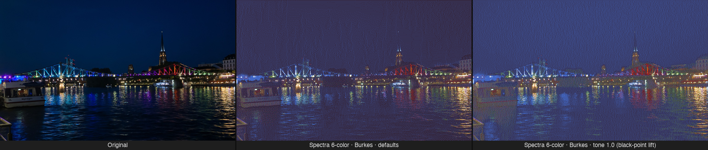

# epaper-dithering-core

Dithering for e-paper / e-ink displays: an image and your panel's palette in, palette indices out.

- **Runtime palettes** — each entry has a measured CIELAB appearance (normalised to the panel's white) and, for pure inks, a name and nominal colour. Load them from `epaper-palette` JSON files; no palettes are built in.
- **Requested inks stay solid** — exact ink colours snap to their ink, and anchoring maps every ink's nominal onto its measured appearance before matching
- **Weighted Cartesian OKLab color matching** — perceptually accurate, hue-preserving, no achromatic-attractor bug
- **7 error diffusion kernels** — Floyd-Steinberg, Atkinson, Burkes, Stucki, Sierra, Sierra Lite, Jarvis-Judice-Ninke — plus Dizzy and ordered (Bayer 4×4) dithering
- **Pre-dither knobs** — exposure, saturation, shadows, highlights, gamut compression; black-point compensation is part of anchoring
- **DBS refinement** — optional Direct Binary Search for how the result is perceived

## Examples



## Usage

```rust
use epaper_dithering_core::{dither, enums::DitherMode, palette::Palette, types::ImageBuffer, DitherOptions};

let palette = Palette::from_json(&std::fs::read_to_string("my_panel.json")?)?;

// pixels: flat RGB bytes, row-major (width × height × 3)
let img = ImageBuffer::new(&pixels, width)?;
let indices = dither(&img, &palette, &DitherOptions {
    mode: DitherMode::FloydSteinberg,
    ..Default::default()
});
```

Building a palette from absolute measurements (paper white at L\* 68 here) normalises it so the
`white` entry becomes exactly L\* 100, a\* = b\* = 0:

```rust
use epaper_dithering_core::palette::{Ink, Lab, Palette, PaletteEntry};

let ink = |name: &str, nominal| Some(Ink { name: name.into(), nominal });
let palette = Palette::from_absolute_lab(
    vec![
        PaletteEntry { appearance: Lab { l: 68.26, a: 8.33, b: 5.98 }, ink: ink("white", [255, 255, 255]) },
        PaletteEntry { appearance: Lab { l: 3.19, a: 4.55, b: 1.38 }, ink: ink("black", [0, 0, 0]) },
        PaletteEntry { appearance: Lab { l: 49.58, a: 4.63, b: 1.68 }, ink: None }, // an unnamed mix
    ],
    0,    // index of the white entry
    true, // measured
)?;
std::fs::write("my_panel.json", palette.to_json())?;
```

`Palette::new` rejects a `white` entry more than ΔE 0.5 from L\* 100 (the error names
`from_absolute_lab`), fewer than 2 or more than 256 entries, and duplicate ink names or nominals.
Example files live in the repository's `examples/palettes/`; they are not part of the crate.

`DitherOptions` defaults: `Burkes`, `serpentine: true`, `exposure: 1.0`, `saturation: 1.0`,
`shadows: 0.0`, `highlights: 0.0`, `gamut: None`, `dbs: None`,
`anchor: true`, `snap: true`.

Pipeline order: `exposure → saturation → shadows/highlights → anchor → gamut → match + diffuse → dbs`.
Snapping is decided on the original input: a pixel exactly equal to an ink's nominal takes that
ink and is pinned through diffusion and DBS, even when other adjustments are on.

`DitherMode::None` maps each pixel to its nearest colour without diffusion; on limited palettes a
flat mid-tone can land on an unexpected ink, so use an error-diffusion mode for photos. Modes parse
from and print as snake_case names (`"floyd_steinberg"`).

## Related packages

- Python: [`epaper-dithering`](https://pypi.org/project/epaper-dithering/)
- JavaScript: [`@opendisplay/epaper-dithering`](https://www.npmjs.com/package/@opendisplay/epaper-dithering)
